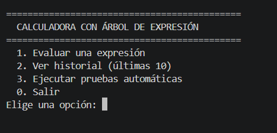
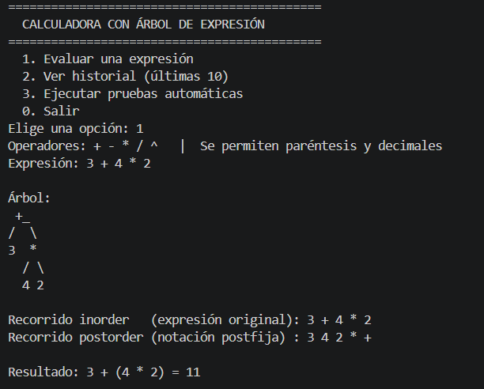
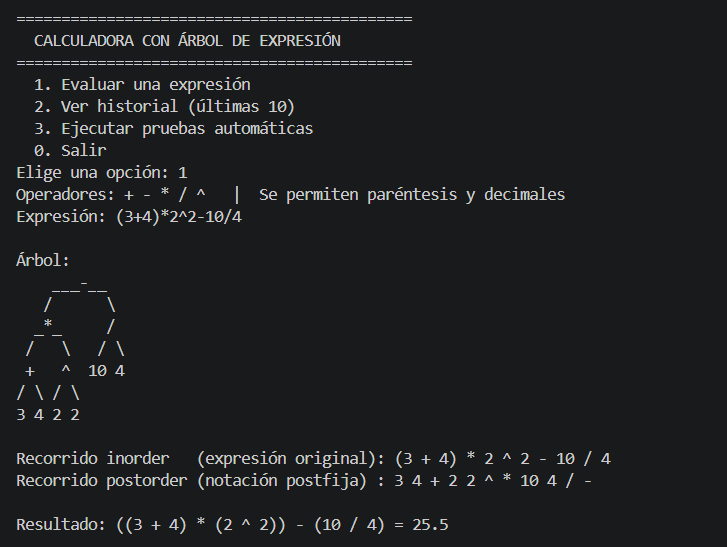
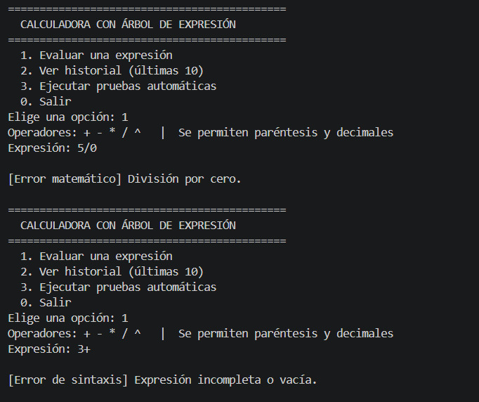
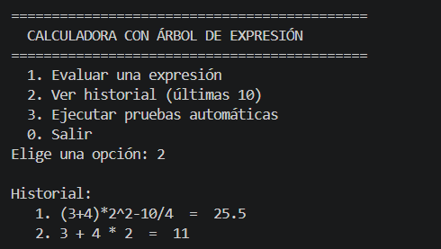
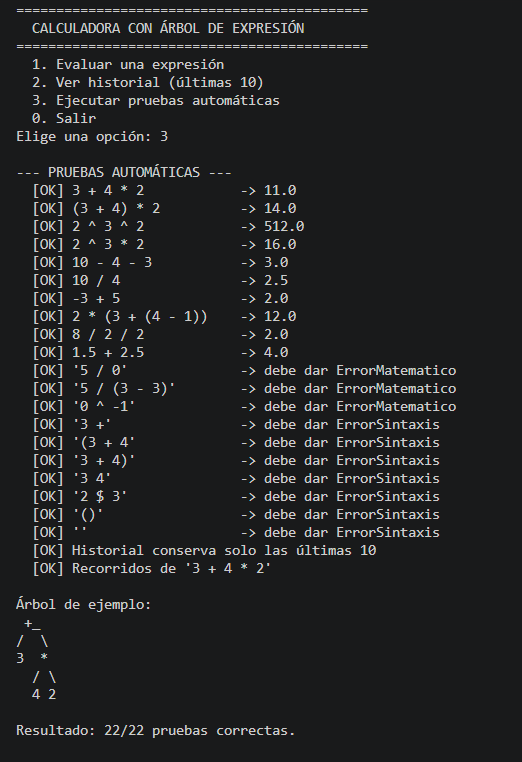

# Calculadora Básica con Árbol de Expresión

**Curso:** Estructuras de Datos – 
**Batería 3 – Ejercicio 2**

## Integrantes

| N.º | Nombre completo |
|-----|-----------------|
| 1   | _Escandon Inga Carlos Anthony_ |
| 2   |  _Lazaro Cortez Valeria Rubi_  |

---

## 1. Introducción al problema

Una calculadora no solo debe dar el resultado de `3 + 4 * 2`, también debe respetar la **precedencia de los operadores** (primero `4 * 2`, luego la suma). Para lograrlo, internamente la expresión puede representarse como un **árbol de expresión**: un árbol binario donde cada nodo interno es un operador (`+`, `-`, `*`, `/`, `^`) y cada hoja es un número.

Este proyecto implementa una calculadora en Python que:

- Acepta expresiones en **notación infija** (`2 + 3 * 4`) con paréntesis y decimales.
- Las convierte en un **árbol binario de expresión** construido desde cero.
- Evalúa el árbol **usando recursión**.
- Muestra el árbol de forma visual, los recorridos **inorder** y **postorder**, y el resultado.
- Maneja errores (**división por cero** y **sintaxis incorrecta**).
- Guarda un **historial de las últimas 10 expresiones** evaluadas.

Restricción del trabajo: no se usan librerías externas para las estructuras de datos; el árbol, los nodos y la pila son clases propias.

Ejemplo del enunciado, `3 + 4 * 2`:

```
 +_
/  \
3  *
  / \
  4 2

Resultado: 3 + (4 * 2) = 11
```

---

## 2. Estructura de datos elegida

### 2.1 Árbol binario de expresión

Se eligió un **árbol binario** porque la forma del árbol representa directamente la precedencia: las operaciones más "profundas" se evalúan primero.

- **Nodos internos:** operadores, siempre con dos hijos (izquierdo y derecho).
- **Nodos hoja:** números.

```python
class Nodo:
    def __init__(self, valor, izq=None, der=None):
        self.valor = valor      # operador (str) o número (float)
        self.izq = izq
        self.der = der

    def es_hoja(self):
        return self.izq is None and self.der is None
```

Para `3 + 4 * 2` el árbol es:

```
      +
     / \
    3   *
       / \
      4   2
```

### 2.2 Estructuras auxiliares

| Estructura | Uso en el proyecto |
|------------|--------------------|
| **Pila** (clase propia `Pila`) | Convertir infija a árbol: una pila de operadores y otra de subárboles. |
| **Lista de Python** (`historial`) | Guardar las últimas 10 expresiones con su resultado (la más reciente primero). |

```python
class Pila:
    """Pila (LIFO): push, pop y tope en O(1)."""
    def __init__(self):
        self.items = []

    def push(self, x):
        self.items.append(x)

    def pop(self):
        if not self.items:
            raise ErrorSintaxis("Expresión incompleta (faltan operandos).")
        return self.items.pop()

    def tope(self):
        return self.items[-1] if self.items else None

    def vacia(self):
        return not self.items
```

### 2.3 Precedencia

```
potencia (^)  >  multiplicación / división (* /)  >  suma / resta (+ -)
```

La resta y la división se asocian de izquierda a derecha (`10 - 4 - 3 = 3`), mientras que la potencia se asocia de derecha a izquierda (`2 ^ 3 ^ 2 = 512`).

---

## 3. Descripción de las operaciones implementadas

### 3.1 Tokenización (`tokenizar`)
Recorre el texto carácter por carácter y devuelve una lista de tokens (números, operadores y paréntesis). Reconoce números enteros y decimales, el signo `-` unario pegado a un número (`-3 + 5`), operadores y paréntesis. Cualquier otro carácter genera `ErrorSintaxis`.

### 3.2 Construcción del árbol (`construir`)
Usa el algoritmo de las dos pilas (variante de *Shunting-Yard*). Cada vez que un operador debe "cerrarse", se saca de la pila de operadores, se sacan dos subárboles de la pila de nodos y se crea un nuevo nodo interno:

```python
def reducir(ops, nodos):
    op = ops.pop()
    der = nodos.pop()
    izq = nodos.pop()
    nodos.push(Nodo(op, izq, der))
```

La regla de precedencia está en el `while` que decide cuándo reducir:

```python
while ops.tope() not in (None, '(') and (
        PRIORIDAD[ops.tope()] > PRIORIDAD[t] or
        (PRIORIDAD[ops.tope()] == PRIORIDAD[t] and t != '^')):
    reducir(ops, nodos)
```

Durante la construcción se valida el orden de los tokens (por ejemplo, `3 4`, `3 +`, `()` o paréntesis sin cerrar generan `ErrorSintaxis`).

### 3.3 Evaluación recursiva (`evaluar`)
Caso base: una hoja devuelve su número. Caso recursivo: se evalúan los hijos izquierdo y derecho y se aplica el operador del nodo.

```python
def evaluar(n):
    if n.es_hoja():
        return n.valor
    a, b = evaluar(n.izq), evaluar(n.der)
    if n.valor == '+': return a + b
    ...
    if n.valor == '/':
        if b == 0:
            raise ErrorMatematico("División por cero.")
        return a / b
```

### 3.4 Recorridos
- **Inorder** (izquierda, raíz, derecha): reconstruye la expresión original, agregando solo los paréntesis necesarios. Con `total=True` pone paréntesis en cada subexpresión (`3 + (4 * 2)`), que se usa para mostrar el resultado.
- **Postorder** (izquierda, derecha, raíz): produce la notación postfija (`3 4 2 * +`).

### 3.5 Visualización del árbol (`dibujar`)
Dibuja el árbol en texto con la raíz arriba. Cada subárbol se dibuja recursivamente y luego se unen los dibujos izquierdo y derecho debajo del operador.

### 3.6 Historial (`historial`)
Lista que inserta al inicio (`insert(0, ...)`) y, si hay más de 10 elementos, elimina los más antiguos (`del historial[10:]`). Solo se guardan las expresiones evaluadas correctamente.

### 3.7 Manejo de errores

| Situación | Excepción | Ejemplo |
|-----------|-----------|---------|
| División por cero | `ErrorMatematico` | `5 / 0`, `5 / (3 - 3)` |
| Potencia inválida | `ErrorMatematico` | `0 ^ -1` |
| Sintaxis incorrecta | `ErrorSintaxis` | `3 +`, `(3 + 4`, `3 4`, `2 $ 3`, `()` |

### 3.8 Menú interactivo

```
1. Evaluar una expresión
2. Ver historial (últimas 10)
3. Ejecutar pruebas automáticas
0. Salir
```

### 3.9 Cómo ejecutarlo

```bash
python calculadora_arbol.py            # menú interactivo
python calculadora_arbol.py --pruebas  # solo el bloque de pruebas
```

Requiere Python 3 y no necesita instalar librerías.

---

## 4. Análisis de complejidad (Big O)

Sea **n** la cantidad de tokens de la expresión y **h** la altura del árbol (en un árbol equilibrado h ≈ log n; en el peor caso, h = n).

| Operación | Tiempo | Espacio extra | Justificación |
|-----------|--------|---------------|---------------|
| `push`, `pop`, `tope` (Pila) | O(1) | O(1) | Solo se modifica el nodo del tope. |
| Tokenizar | O(n) | O(n) | Se recorre el texto una vez. |
| Construir el árbol | O(n) | O(n) | Cada token se apila y se desapila a lo sumo una vez. |
| Evaluar | O(n) | O(h) | Cada nodo se visita una sola vez; la pila de recursión llega hasta h. |
| Recorrido inorder / postorder | O(n) | O(h) | Se visita cada nodo una vez (la concatenación de texto de Python puede añadir un costo menor, irrelevante para expresiones cortas). |
| Dibujar el árbol | O(n · h), peor caso O(n²) | O(n · h) | Cada unión de subárboles recorre todas sus líneas. Solo se usa para mostrar. |
| Historial: agregar | O(k), k ≤ 10 | O(1) | Insertar al inicio desplaza como máximo 10 elementos (constante en la práctica). |
| Historial: mostrar | O(k), k ≤ 10 | O(1) | Se recorre la lista del historial. |

**Total de una evaluación completa** (tokenizar + construir + evaluar): **O(n)**.

---

## 5. Pruebas

El archivo incluye un bloque de pruebas al final (`ejecutar_pruebas`) con 22 casos: 10 expresiones válidas, 10 que deben producir error, el límite del historial y los recorridos del ejemplo del enunciado.

Resultado obtenido: **22/22 pruebas correctas**.

---

## 6. Capturas de pantalla del programa en ejecución

**Ejecución:** las capturas se encuentran en la carpeta `capturas/` del repositorio.

1. Menú principal: `capturas/01_menu.png`
2. Evaluación de `3 + 4 * 2` con árbol, recorridos y resultado: `capturas/02_evaluacion.png`
3. Evaluación con paréntesis y potencia, por ejemplo `(3+4)*2^2-10/4`: `capturas/03_parentesis.png`
4. Manejo de errores (`5/0` y `3 +`): `capturas/04_errores.png`
5. Historial: `capturas/05_historial.png`
6. Pruebas automáticas (`--pruebas`): `capturas/06_pruebas.png`










---

## 7. Conclusiones del equipo

- El árbol de expresión representa la precedencia con su propia forma, así que la evaluación se reduce a una recursión sencilla.
- Las pilas fueron clave para convertir la notación infija en árbol y manejar los paréntesis.
- Implementar el árbol, los nodos y la pila desde cero permitió entender sus costos: las operaciones de la pila son O(1) y una evaluación completa es O(n).
- Validar el orden de los tokens durante la construcción permitió detectar errores de sintaxis con mensajes claros, sin que el programa se caiga.
- Posibles mejoras: soportar funciones (`sqrt`, `sin`), el menos unario antes de paréntesis (`-(3+2)`) y una visualización gráfica del árbol.
